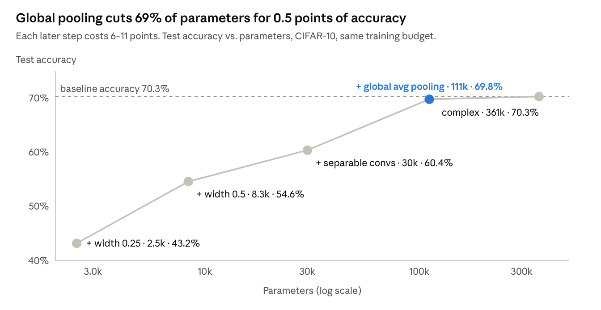

# Optimization Course: Instructor's Guide

John Hebeler · November 2026

## Course overview

This repo teaches students to judge a model on two axes at once: how good it is (metrics) and what it costs (time, memory, size). Then it shows how to shrink a model without losing much quality. It supports the Model domain of the Production AI semester project ([Production AI Brief Outline Spring 2025](Production%20AI%20Brief%20Outline%20Spring%202025-1.pdf)), worth 35% of the project grade.

| Project deliverable (Spring 2025 outline) | Module | Weight | Notebooks that prepare it |
| --- | --- | --- | --- |
| Model Candidates Selection (minimum 2) | 5 | 10% | 1, 1B, 2, 3, 4 (pick metrics that fit the task) |
| Model Performance Determination | 6 | 5% | 1, 1B, 2, 3, 3B, 4, `12LLMReview.py` |
| Model Resource Use Determination | 6 | 5% | 5, 10 |
| Model Selection, Inference Export, and Governance | 7 | 15% | 6, 7, 7B, 8, 9 |

**Learning outcomes.** By the end, a student can:

1. Pick metrics that match the model type (classification, regression, clustering, RL, generative) and explain why accuracy alone misleads.
2. Measure latency, throughput, size and memory correctly, including warm-up, repeats and percentiles.
3. Apply pruning, factorization, distillation, quantization, architecture reduction and transfer learning, and report the quality-versus-cost trade-off for each.
4. Defend choosing the smallest model that meets a stated accuracy requirement.

**Audience and prerequisites.** Students should already read Python and basic NumPy/pandas, and know what training, validation and test splits are. The notebooks explain TensorFlow and PyTorch code inline, so prior framework experience helps but is not required.

Open question: the project dates above are from Spring 2025. Confirm the module numbers for the current term.

## Setup and environment

Everything runs on a laptop CPU with Python 3.12. Students can watch the session without installing anything. For their project work they will need it, and TensorFlow and PyTorch together download about 2 GB.

```bash
git clone git@github.com:AI-Demonstrations/Optimization.git && cd Optimization
python3.12 -m venv .venv && source .venv/bin/activate
pip install -r requirements.txt
jupyter lab
```

- **Run from the repo root.** Notebooks open `Data/...` with relative paths.
- **Versions.** `requirements.txt` pins the release lines the notebooks were last run with (Nov 2026): TensorFlow 2.21, PyTorch 2.15, torchao 0.18, transformers 5.22, gymnasium 1.4.
- **First-run downloads.** CIFAR-10 (notebooks 7, 7B), ImageNet MobileNetV2 weights (9), and Hugging Face models: GPT-2 (4, `12LLMReview.py`), OPT-125m (6, 8), and MiniLM sentence embeddings (4). Campus networks that block Hugging Face will fail here, so pre-download if needed.
- **GPU.** Optional. It mainly speeds up 7, 7B and 9. Timing numbers in 5, 8 and 10 change on GPU, which is a good discussion point, not a bug.
- **LLM judge (optional).** `12LLMReview.py` calls the Claude API for its judge step if `ANTHROPIC_API_KEY` is set (or `ant auth login` was run), and skips it otherwise. Run it live in lecture from an instructor key rather than asking students to buy credits.

**Approximate CPU run times** (12-core desktop, models already downloaded; add a few minutes for first-run downloads):

| Notebook | Run time | Main cost |
| --- | --- | --- |
| 7B | \~10 min | Trains 5 CNNs on CIFAR-10 |
| 9 | \~5 min | MobileNetV2 feature extraction + fine-tuning on 4,000 images |
| 7 | \~2 min | Trains 2 CNNs |
| 3B | \~1 min | 5,000 CartPole episodes |
| 6 | \~40 s | Perplexity passes over pruned and factorized OPT-125m |
| 8 | \~20 s | Perplexity and latency for 5 quantized variants |
| All others | under 15 s | |

Run 7B and 9 before the session and present their saved outputs.

## Running it as one live session

The whole repo fits one 2.5-hour session if you run only the fast notebooks live and show saved outputs for the slow ones. The file numbers are not the presenting order: show 5 before 10, and 7 → 7B → 6 → 8 → 9, since each of those notebooks points to the next.

**Before the session (about 30 minutes):**

- [ ] Run 7B (\~10 min) and 9 (\~5 min) so their outputs are fresh; present those from saved output.
- [ ] Run every other notebook once so all models and datasets are downloaded and cached.
- [ ] Set `ANTHROPIC_API_KEY` in the shell that runs `12LLMReview.py`.
- [ ] Open all notebooks in tabs in presenting order, with kernels started.

**Agenda:**

| Time | Segment | Notebooks | Live or saved | Land this point |
| --- | --- | --- | --- | --- |
| 0:00–0:05 | Framing | — | — | Every model is judged on quality *and* cost; map them to the project's Model deliverables |
| 0:05–0:45 | Measuring quality | 1 (12 min), 1B (2), 2 (4), 3 + 3B (8), 4 + `12LLMReview.py` (14) | Live; start 3B early, it takes \~1 min | Accuracy misleads; thresholds are business choices; overlap metrics miss meaning |
| 0:45–1:10 | Measuring cost | 5 (8), 10 (17) | Live | Warm up, repeat, report p95/p99, measure at the batch size you'll serve |
| 1:10–1:15 | Break | | | |
| 1:15–2:15 | Making models smaller | 7 (6), 7B (12), 6 (15), 8 (15), 9 (12) | 6, 8 live; 7, 7B, 9 from saved output | Find where the parameters are; measure quality, size and speed for every variant |
| 2:15–2:30 | Apply to the project + Q&A | — | — | Walk through the trade-off rubric below |

If you run short, cut 1B, 2 and 3B to a one-minute mention each. Their points are covered by 1 and 3.

## Measuring quality

The theme: every metric answers one narrow question, and a single number can look great while the model fails at the job.

### 1 — Supervised metrics (diabetes)

- **Open with the trap.** Only 8.5% of the 100,000 patients are diabetic. The always-"no" baseline scores 91.5% accuracy and 0% recall.
- **The trained network:** 97.2% accuracy, 99.7% precision, but only 67.6% recall. It misses 551 of 1,700 diabetic patients.
- **The threshold table is the key exhibit.** At 0.5 there are 3 false alarms and 551 missed cases. At 0.1 there are 1,613 false alarms and 180 missed cases. Choosing between them is a business decision, not a modeling one.
- **Regression part:** R² 0.453 vs. a mean-predictor baseline of −0.012. RMSE 53.9 is in the target's own units, which makes it easier to explain than MSE.
- *Ask:* For a screening program, what does one missed case cost compared with one extra follow-up test? Which threshold follows from that?

### 1B — Multi-class metrics (Iris)

- 96.7% test accuracy, with one versicolor misread as virginica. Macro averaging and one-vs-rest ROC (AUC 0.997) are the new ideas.
- Point out that the test set is only 30 rows, so one error moves accuracy by 3.3 points.
- *Ask:* When would weighted averaging and macro averaging give very different answers?

### 2 — Unsupervised metrics (clustering)

- On synthetic blobs: silhouette 0.79, Davies-Bouldin 0.29, ARI 0.99. Silhouette and Davies-Bouldin agree that k = 4 is best.
- Stress that inertia always falls as k grows, so it cannot choose k alone. ARI is only available because the data is synthetic and comes with true labels.
- *Ask:* In a real customer-segmentation project with no labels, which of these metrics could you still use?

### 3 and 3B — Reinforcement learning

- **3 (FrozenLake):** the training success rate is 88.9%, but the greedy policy succeeds 100% of the time in the optimal 6 steps. Training metrics include exploration noise, so evaluate the policy greedily.
- **Robustness is the memorable result.** The same policy on the slippery lake succeeds only 3.9% of the time.
- **3B (CartPole):** the best checkpoint averages 500 (solved), but the final Q-table averages 96. Keep the best policy, as with early stopping. The Q-table grows as bins^variables, which motivates DQN.
- *Ask:* What is the RL equivalent of a held-out test set?

### 4 and `12LLMReview.py` — Generative metrics

- **Notebook 4:** BLEU and ROUGE reward word overlap. A paraphrase scores BLEU 0.06, while embedding similarity still rates it 0.65 against 0.01 for unrelated text. GPT-2's own rambling gets the lowest perplexity (19), because perplexity measures predictability, not correctness.
- **`12LLMReview.py`** is the punchline. A sentence with the facts flipped ("the lazy brown dog jumps over the quick fox") gets ROUGE-1 = 1.0 and beats the correct paraphrase on BLEU (0.17 vs. 0.06). Only the LLM judge, which reads for meaning, ranks it last.
- Run the script live with a key and have students predict the judge's scores before revealing them.
- *Ask:* What are an LLM judge's own failure modes (cost, latency, bias toward longer or same-style answers), and how would you check the judge?

## Measuring cost

The theme: a timing number is only meaningful with its method stated (clock, warm-up, repeats, batch size, hardware). These two notebooks give students the method they need for the Resource Use deliverable.

### 5 — Timing basics

- `time.perf_counter()`, not `time.time()`, and always warm up first: the first call pays one-time costs.
- **The batching result:** one prediction takes about 246 µs, but in a batch of 1,000 it costs about 0.39 µs per row, a 632× speed-up. Most of the single-call time is per-call overhead, not math.
- Report the mean and spread over repeats (2.69 ms ± 0.10 ms), or let `timeit` / `%timeit` do the loop.
- *Ask:* Why might the minimum of repeated runs be a better estimate of the code's cost than the mean?

### 10 — Latency, throughput, memory, profiling

- **Percentiles:** mean 0.077 ms, but p99 0.101 ms and max 0.191 ms. Users notice the tail, so service-level targets are written as p95/p99.
- **Batch size trade-off:** throughput rises from about 13,000 to 80,000 samples/s by batch 32, then flattens, while each batch's latency keeps climbing. Throughput is not monotonic (it dips at 512), which makes a good "measure, don't assume" moment.
- **Memory:** the model is 5.29 MB on disk (1.32M params × 4 bytes). Activation memory grows from 0.03 MB at batch 1 to 16.8 MB at batch 512.
- **Profiling:** `aten::addmm` (matrix multiply) takes about 96% of the time. `cProfile` does the same for any Python code, such as a scikit-learn pipeline.
- On GPU, the `sync()` helper matters because GPU calls return before they finish. Without it the timings are wrong.
- *Ask:* An online service needs p99 under 50 ms and a nightly batch job needs maximum throughput. What batch size would you pick for each?

## Making models smaller

The theme: find where the parameters and compute actually are, apply one technique at a time, and record quality, size and speed for each. This produces the trade-off table the Model Selection deliverable asks for.

### 7 — Complex vs. simplified CNN

- The "simplified" CNN is only 1.14× smaller (316k vs. 361k params). Dropping a pooling stage made its `Flatten` → `Dense` input larger. Count parameters; don't count layers.
- Accuracy is nearly equal (68.5% vs. 68.1%) and single-image latency is 1.37× better, so the smaller model wins if it is within tolerance.
- *Ask:* What accuracy loss would your project's users accept for a 2× speed-up?

### 7B — Systematic reduction

- Start by profiling parameters: the first `Dense` layer holds 72.8% of the weights.
- Global average pooling removes about 70% of the parameters for 0.5 points of accuracy. After that, separable convolutions and width multipliers each cost real accuracy (chart below).
- **Surprise worth discussing:** fewer parameters did *not* lower single-image latency, because per-call framework overhead dominates small models. Batch throughput did improve.



*Source: `7B_W_SimpleDeepReduction.ipynb` saved outputs · 5 models, CIFAR-10 test set.*

The knee is the lesson: past global pooling, every further cut buys size with accuracy.

### 6 — Pruning, low-rank factorization, distillation (OPT-125m and digits)

| Technique | Setting | Effect on size | Perplexity / accuracy |
| --- | --- | --- | --- |
| Baseline OPT-125m | — | 125.2M params, 501 MB | perplexity 31.7 |
| Unstructured pruning | 10% / 50% of weights zeroed | file size unchanged (501 MB) | 32.4 / 136.6 |
| SVD low-rank (fc layers) | rank 512 of 768 | −7.5% params | 111.1 |
| Distillation (digits) | 2,410-param student, 100 labels | 125× smaller than teacher | 94.6% vs. 87.2% without teacher (teacher 97.4%) |

- Pruning zeroes weights but keeps tensor shapes, so the file is no smaller and no faster without sparse storage or kernels. Students often expect otherwise.
- Plain SVD is a poor trade because trained LLM weights are not close to low-rank. Connect this to LoRA, which uses low rank for the *update* instead.
- Distillation pays off when unlabeled data is plentiful, which is exactly the LLM situation.

### 8 — Quantizing a language model

| Variant | Size | Perplexity | Latency vs. fp32 |
| --- | --- | --- | --- |
| float32 | 501 MB | 31.66 | 1.00× |
| int8 weight-only (torchao) | 247 MB | 31.53 | 0.80× (slower) |
| int8 weight-only + bf16 | 166 MB | 31.66 | 0.23× |
| bfloat16 | 251 MB | 31.77 | 0.24× |
| int8 dynamic (legacy torch.ao) | 285 MB | 36.48 | 1.63× (faster) |

- Quantization changes bytes per parameter, not the parameter count.
- int8 is about 2×, not 4×, smaller because the 40M-parameter embedding table is not an `nn.Linear` and stays float32.
- The CPU speed results flip with hardware: bf16 is slow on CPUs without native support. Measure on the deployment target.
- *Ask:* Which variant would you ship to a phone? Which to a CPU server? Which to a GPU?

### 9 — Transfer learning (MobileNetV2, cats vs. dogs)

- Training only the new head (1,281 parameters, 0.06% of the model) reaches 97.7% validation accuracy in 3 epochs on 4,000 images. Fine-tuning the top layers adds only 0.3 points.
- **Data hygiene is part of the lesson.** The loader skips about 25,000 NAS thumbnail files and a Photoshop file named `.jpg`. Real data is messy, and silent bad inputs corrupt training.
- Review the misclassified images in class; many are ambiguous or mislabeled.
- *Ask:* When is fine-tuning worth its cost over training the head alone?

## Common pitfalls and troubleshooting

| Symptom | Cause | Fix |
| --- | --- | --- |
| `FileNotFoundError: Data/...` | Notebook launched from another folder | Start Jupyter from the repo root |
| Hugging Face or CIFAR download hangs or fails | Blocked or slow network on first run | Pre-download on a good connection; models cache in `~/.cache/huggingface` |
| Numbers differ from the saved outputs | Different hardware, random seeds, library versions | Expected for timings; accuracy should land within a few points. Treat it as a discussion point |
| bf16 or int8 runs *slower* than float32 in 8 | CPU lacks native kernels for that format | Expected on many CPUs. This is the lesson, not a bug |
| `torchao` "Failed to load ... .so" warnings | Optional GPU kernels missing in the CPU build | Harmless on CPU; ignore |
| `12LLMReview.py` prints "Judge skipped" | No `anthropic` package or no API credentials | `pip install anthropic pydantic` and set `ANTHROPIC_API_KEY` |
| Notebook 9 crashes mid-epoch on an image | Student wrote their own loader without the header check | Reuse `list_images()`; it skips non-image files and `@eaDir` folders |
| Out-of-memory in 7B or 9 on small laptops | Batch size too large for available RAM | Lower `BATCH_SIZE` in 9 (or `batch_size` in the 7B `fit` call), or run in Colab |

Conceptual mistakes to watch for in project write-ups:

- Reporting accuracy alone on imbalanced data.
- Tuning on the test set instead of a validation split.
- Timing a single cold call, or quoting the mean latency without p95/p99.
- Claiming pruning made a model smaller or faster without measuring file size and latency.
- Comparing perplexity across models with different tokenizers. It is only comparable for the same tokenizer and text.

## Assignment and assessment ideas

The strongest assignment applies the notebooks to the student's own project model, since that is what the Module 6 and 7 deliverables grade. Short exercises on the notebooks themselves work as warm-ups.

**Project-linked (recommended):**

1. **Performance determination (Module 6).** Pick at least three metrics suited to your model type, report a baseline beside each, and justify the decision threshold or operating point in terms of your application's costs.
2. **Resource use determination (Module 6).** Report size on disk, peak inference memory, p50/p95/p99 latency at batch 1, and throughput at two batch sizes. State the hardware and method (warm-up, number of repeats).
3. **Model selection (Module 7).** Apply at least two reduction techniques (from 6, 7B, 8 or 9) to your model. Submit a trade-off table (quality, size, latency) and pick the smallest model that meets a stated accuracy requirement.

**Notebook exercises (follow-ups after the session):**

- **1:** Assign a cost to a missed case and a false alarm, then find the threshold that minimizes total cost.
- **3:** Train on the slippery lake and compare robustness with the non-slippery policy.
- **4 / `12LLMReview.py`:** Write five candidate pairs that fool BLEU/ROUGE in each direction. Check whether the LLM judge catches them.
- **10:** Re-run on a GPU or a different laptop and explain which numbers moved and why.
- **7B:** Add a reduction step of your own (fewer conv layers, smaller input) and place it on the size-vs-accuracy chart.
- **8:** Combine pruning from 6 with int8 quantization and measure whether the effects stack.

**Rubric for a trade-off report:**

| Criterion | Strong | Weak |
| --- | --- | --- |
| Metric choice | Fits the task and data balance; includes a baseline | Accuracy only, no baseline |
| Measurement method | Warm-up, repeats, percentiles, hardware stated | Single run, mean only |
| Trade-off evidence | Quality, size and speed measured for every variant | Size or speed assumed, not measured |
| Decision | Smallest model meeting a stated requirement, with a reason | "Bigger is better" or no requirement stated |

## Maintaining the repo

The repo was last refreshed and re-run in November 2026. Re-run every notebook before each term, because library updates (especially transformers, torchao and TensorFlow) are the usual cause of breakage.

- **Re-run all notebooks** from the repo root and check for error outputs:

  ```bash
  for nb in [0-9]*.ipynb; do jupyter nbconvert --to notebook --execute --inplace "$nb" || echo "FAILED $nb"; done
  ```

- **Version pins.** `requirements.txt` uses `~=` pins on the tested release lines. After a successful re-run on newer versions, raise the pins and the "Tested with" date at its top.
- **Data.** `Data/diabetes.csv` (notebook 1), `Data/llm_eval_text.txt` (6, 8) and `Data/train` + `Data/validation` (9, about 1 GB of Kaggle Dogs vs. Cats images) are committed. The NAS creates `@eaDir` folders; `.gitignore` excludes them and notebook 9 skips them.
- **Archive.** `archive/` holds the 2025 drafts that the numbered notebooks replaced. They use outdated APIs and are not maintained. Delete the folder when nobody needs it for reference.
- **LLM judge model.** `12LLMReview.py` sets `JUDGE_MODEL = "claude-opus-5-5"`. Update it when a newer model is released.
- **Branches.** GitHub's default branch is `main`, and local work happens on `master`. Push both (`git push origin master master:main`) so students see changes on the GitHub page.
